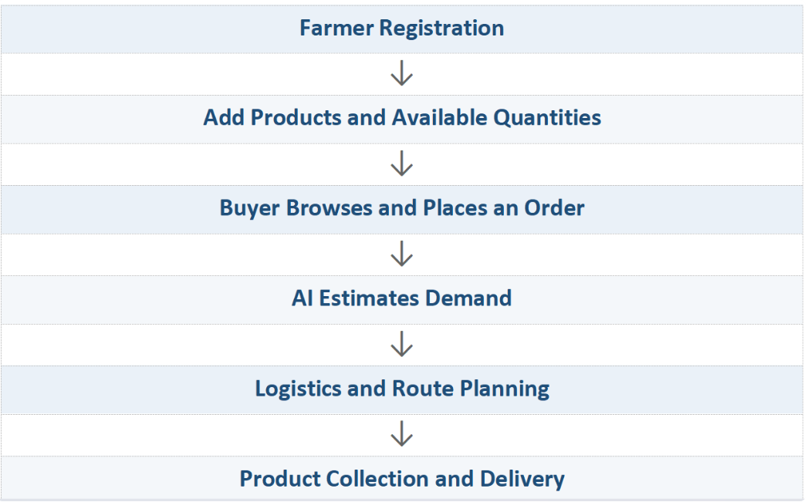

# Smart India Hackathon Workshop
# Date: 22-11-2026
## Reference Number: 26014162
## Name: S.Surajkanth

## Problem Title
SIH 26033: Multiple intermediaries reduce farmers earnings and increase consumer prices.

## Problem Creater's Organization
Ministry of Consumer Affairs, Food & Public Distribution

## Theme
Agriculture, FoodTech & Rural Development

## Problem Description
Expected Solution: Create a digital marketplace that:

1. Connects farmers/FPOs directly with consumers and bulk buyers.
2. Provides logistics support.
3. Uses AI for demand forecasting and route optimization.

Benefits:

1. Better prices for farmers.
2. Lower prices for consumers.
3. Reduced supply chain inefficiencies.

## Proposed Solution
Detailed Explanation of the Proposed Solution
Our idea is to build KisanGrow , a direct farm-to-buyer digital marketplace that replaces the traditional multi-layered mandi chain with a single, transparent platform. Instead of forcing small farmers to sell their harvest through four or five local brokers and commission agents, the platform brings farmers, Farmer Producer Organizations (FPOs), bulk buyers such as restaurants, supermarkets, and hostels and everyday household consumers onto one connected network.

The system works across three simple modules:

1.Farmer & FPO App: A simple, regional-language mobile interface where farmers or FPO coordinators list what crops are ready for harvest, how much stock is available, and their expected base price.

2.Buyer Marketplace: A web and mobile storefront where bulk buyers can lock in pre-harvest contracts, and regular consumers can buy fresh produce directly or join neighborhood group orders.

3.Shared Logistics Network: An integrated transport module that connects local mini-truck and tempo owners to pick up produce directly from farms and deliver it to buyers or local drop-off hubs.
How It Addresses the Problem
Right now, a farmer often gets less than 30% to 40% of what a consumer pays at a retail store because every middleman along the way adds handling charges, transport markups, and profit margins. By letting buyers purchase directly from the source, farmers immediately earn a much fairer share of the final price, while consumers get fresher food at noticeably lower rates.
At the same time, individual small farmers usually do not grow enough produce to fill an entire truck on their own, which is why they depend on local aggregators. Our platform solves this by grouping nearby farm orders together so one vehicle can pick up harvests from multiple neighboring farms in a single trip. Meanwhile, AI demand forecasting helps farmers see what crops will be in high demand over the coming weeks so they don't get stuck with unsold stock during market gluts.

Innovation and Uniqueness of the Solution

1.Smart Farm-Cluster Routing: Most delivery apps are built for point-to-point city deliveries. Our routing engine is designed specifically for rural pickups—it looks at crop shelf-life, farm locations, and vehicle capacity to create the fastest, lowest-cost pickup loop across multiple small farms.

2.Photo-Based Quality Grading: Bulk buyers often hesitate to buy online because they cannot inspect the crop in person. We solve this by letting farmers take a quick photo of their produce; a lightweight computer vision model checks size, color, and visible defects to assign a standard quality grade (Grade A, B, or C) before listing.

3.Neighborhood Group-Buying: Individual households can team up with neighbors in the same apartment complex or street to place a combined order, unlocking wholesale prices while keeping last-mile delivery simple.

## Technical Approach

Technologies to be Used

1.Mobile & Web Frontend: Flutter for a lightweight Android app that works smoothly on budget phones and weak rural internet and React.js for the bulk buyer and admin web portals.
2.Backend & Core APIs: Python with Django REST Framework to handle user accounts, order matching, pricing logic, and database operations securely.
3.Database & Location Services: PostgreSQL with PostGIS to store farm coordinates, calculate distances, and manage geospatial pickup zones, paired with Redis for fast caching.

AI & Machine Learning:

1.Demand Forecasting: Facebook Prophet and XGBoost trained on historical mandi arrival data, seasonal consumption trends, and local weather forecasts.
2.Route Optimization: Google OR-Tools to solve the Capacitated Vehicle Routing Problem for multi-farm pickups.
3.Crop Quality Check: TensorFlow Lite running a compact Convolutional Neural Network directly on the phone for instant photo grading.
4.Payments & Hardware Integration: UPI / Razorpay Route for automated split payments directly to farmers' bank accounts, along with standard QR code stickers for tracking crates during transit.

Methodology and Process for Implementation

1.Onboarding & Verification: Farmers register using their mobile number and basic KYC, or get onboarded in batches through their local FPO. Buyers and local transport drivers verify their details on the app.
2.Harvest Listing: Two to three days before harvest, the farmer enters the crop type, quantity, and uploads a short photo/video. The AI grading tool tags the quality, and the pricing engine suggests a fair rate based on current market demand.
3.Order Matching: Bulk buyers browse available listings and place orders. Retail consumer orders in the same area are automatically bundled into scheduled delivery windows.
4.Route & Pickup Execution: Once orders are confirmed, the route optimization engine assigns a nearby registered vehicle and maps out the shortest multi-stop route across the farms.
5.QR Check-in & Instant Payout: When the driver picks up the crates, both the farmer and driver scan a QR code on the app. This confirms the handover and triggers an instant UPI transfer to the farmer's bank account, removing payment delays.

## Feasibility and Viability
Analysis of the Feasibility of the Idea
1.Technical Feasibility: Every component of this system relies on mature, reliable tools. Low-bandwidth mobile caching ensures farmers in areas with patchy 4G can still save listings offline and sync automatically once connected.
2.Operational Feasibility: Instead of trying to reach millions of individual farmers one by one, partnering with existing FPOs gives us immediate access to organized groups of 300 to 1,000 farmers per organization, making onboarding practical and fast.
3.Financial Viability: The platform follows an asset-light model—we do not need to buy trucks or build expensive warehouses. Revenue comes from a small 3% to 5% platform and logistics fee charged on completed transactions, which is easily absorbed because buyers and farmers are saving 30% to 40% by cutting out middlemen.

Potential Challenges and Risks

1.Digital Comfort Barrier: Many older farmers may not feel comfortable typing crop details or navigating complicated English menus.
2.Crop Spoilage in Transit: Fresh vegetables and fruits can lose quality quickly if pickup vehicles are delayed or exposed to heat.
3.Trust Issues Over Quality: A bulk buyer might claim the delivered produce does not match what was promised on the app.
4.Initial Supply-Demand Imbalance: Getting enough buyers and farmers active in a new district at the exact same time can be tricky during launch.
Strategies for Overcoming These Challenges
5.Voice Input & FPO Coordinators: Add regional voice-to-text search/listing and train one local youth representative per FPO to help farmers list their harvests.
6.Shelf-Life Priority Routing: Program the routing algorithm to always pick up delicate, fast-spoiling crops first and schedule pickups during cooler early-morning hours.
7.Digital Handover Proof: Require photo grading at listing and a quick QR-sealed crate check at pickup so both sides have clear visual proof of quality before transit.
8.Cluster-by-Cluster Rollout: Start in just one or two agricultural districts, locking in assured daily orders from local hostels, restaurants, and apartment communities before expanding further

## Impact and Benefits
Potential Impact on the Target Audience
1.For Farmers and FPOs: Farmers stop being price-takers at the mercy of local brokers. They gain clear visibility into market demand, earn 25% to 35% higher net profits, and receive money straight into their bank accounts on the day of pickup.
2.For Consumers and Bulk Buyers: Households and businesses get farm-fresh, chemical-traceable produce at 15% to 20% lower prices without worrying about sudden middleman price spikes.
3.For Local Transport Owners: Small rural vehicle owners get steady, predictable daily trips instead of waiting idle at transport stands.
Benefits of the Solution
4.Economic Benefits: Keeps more money inside rural farming communities, helps control food inflation for urban families, and creates local jobs in sorting, crate handling, and rural delivery.
5.Social Benefits: Reduces financial stress and debt cycles among small farmers by ensuring fair, transparent trade and timely digital payments.
6.Environmental Benefits: Combining nearby farm pickups cuts down half-empty truck trips and lowers fuel emissions, while faster farm-to-kitchen delivery significantly reduces post-harvest food waste

## Research and References
1.Google

2.SIH Buddy

3.https://timesofindia.indiatimes.com/city/kanpur/complaints-of-farmers-heard-and-resolved-on-spot-during-kisan-diwas/articleshow/135969225.cms

4.https://www.bighaat.com/kisan-vedika/blogs/11-major-problems-faced-by-indian-farmers-in-agriculture?srsltid=AYCX9vKJF3hgb3XhUKW1Xw4YgEKvM4bdDXn97vezRVHAnGL4KhnUSavO

5.ChatGPT

